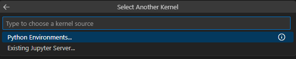

# 🗄️ Step 1 — Vayu Object Storage (Dataset)

**RailOps** › **Vayu Object Storage** · `01_dataset/`

| [← Previous — Step 0 — Vayu AI Studio Workspace](../00_vayu_workspaces/) | [Next — Step 2 — Vayu MLflow →](../02_vayu_mlflow/) |
|:---|---:|

This step provides the railway track telemetry dataset used to train the maintenance model and to drive the dashboard simulator. A copy is already included; the notebook can regenerate it and sync it with **Vayu Object Storage (S3)**. S3 credentials are in the **Access Guide**.

---

<h3>📂 Folder contents</h3>

| File | Purpose |
|------|---------|
| `railway_telemetry.csv` | Synthetic dataset — 2,000 readings across 50 track segments |
| `01_dataset.ipynb` | Generate the dataset, upload it to S3, download it from S3 |

---

<h3>🧬 Dataset schema (<code>railway_telemetry.csv</code>)</h3>

| Column | Description |
|--------|-------------|
| `timestamp` | Reading time (one per minute) |
| `track_id` | Track segment (`TRK-001` … `TRK-050`) |
| `section` | Network section (North / South / East / West) |
| `vibration_hz` | Rail vibration frequency (Hz) — **model feature** |
| `acoustic_emission_db` | Acoustic emission level (dB) — **model feature** |
| `rail_strain_mu` | Rail strain (µε) — **model feature** |
| `track_temperature_c` | Track temperature (°C) — **model feature** |
| `alignment_deviation_mm` | Lateral alignment deviation (mm) — **model feature** |
| `last_maintenance_days` | Days since last maintenance — **model feature** |
| `failure_probability` | Weighted risk score in [0, 1] — **training target** (`> 0.5` → at risk) |
| `risk_level` | `LOW` / `MEDIUM` / `HIGH` / `CRITICAL` (derived from `failure_probability`) |
| `fault_type` | Normal, Excessive Wear, Track Misalignment, Rail Crack, Structural Stress |
| `inspection_status` | Completed / Pending / In Progress |
| `recommended_action` | Monitor, Schedule Inspection, Repair Soon, Immediate Shutdown |
| `assigned_team` | Maintenance crew |
| `action_taken` | Whether the inspection has been completed (`Yes` / `No`) |

The data simulates three regimes — normal (75%), high wear (15%) and emergency (10%).

---

<h3>🚀 Quick start</h3>

1. **Use the included file:** `railway_telemetry.csv` is ready to use — continue to [Step 2](../02_vayu_mlflow/) if you don't need S3.

2. **Sync with S3 (optional):** Open [`01_dataset.ipynb`](01_dataset.ipynb) and select the `.venv` kernel from [Step 0](../00_vayu_workspaces/):

   

   Then run **1. Setup** followed by:
   - **3. Upload** to store the dataset at `S3_DATASET_KEY` in your bucket, or
   - **4. Download** to pull an existing copy from S3.

   Run **2. Generate** only if you want to regenerate the dataset — it overwrites the local CSV.

---

| [← Previous — Step 0 — Vayu AI Studio Workspace](../00_vayu_workspaces/) | [Overview](../README.md) | [Next — Step 2 — Vayu MLflow →](../02_vayu_mlflow/) |
|:---|:---:|---:|
