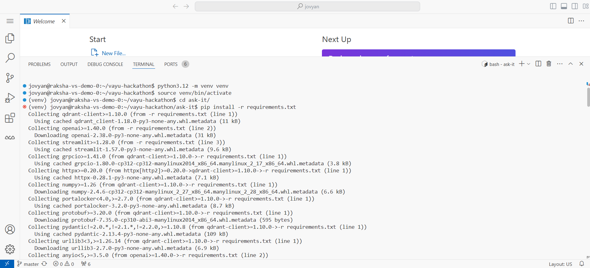
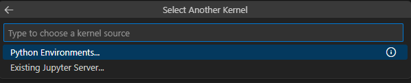
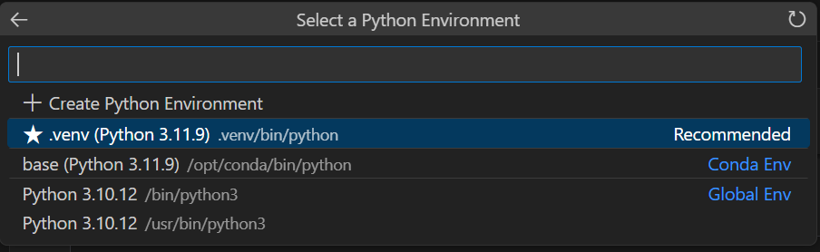

# 🧪 Step 4 — Starter Kit (Training)

**RailOps** › **Starter Kit** · `04_starter-kit/`

| [← Previous — Step 3 — Vayu Kafka](../03_vayu_kafka/) | [Next — Step 5 — Model Registry →](../05_model_registry/) |
|:---|---:|

Train a **Random Forest** classifier that flags railway track segments at risk of failure, log the run to **Vayu MLflow**, and save the model locally for registration.

---

<h3>📂 Folder contents</h3>

| File | Description |
|------|-------------|
| `train_model.ipynb` | Train the model, log params/metrics and register it in MLflow, save `model.joblib` |
| `model.joblib` | Trained model (output of the notebook; input to [Step 5](../05_model_registry/)) |

---

<h3>📋 Prerequisites</h3>

| Step | Vayu Service / Folder | Requirements |
|------|-----------------------|--------------|
| 0 | `00_vayu_workspaces/` | Active Python environment |
| 1 | `01_dataset/` | `railway_telemetry.csv` available locally |
| 2 | `02_vayu_mlflow/` | MLflow deployment **Ready** |
| 3 | `03_vayu_kafka/` | Kafka deployment **Ready** (optional for training) |

Install dependencies:

---

<h3>🚀 Quick start</h3>

1. **Open the training notebook:** `04_starter-kit/train_model.ipynb` in your Vayu AI Studio workspace, then select the kernel:

   1. Open **Select Kernel** and choose **Python Environments**.

      

   2. Under **Select a Python Environment**, pick the **Recommended** environment (it should point to the `.venv` from [Step 0](../00_vayu_workspaces/)).

      

   3. **Validate the path:** Confirm the selected interpreter path ends with `<your-env-name>/bin/python` (for example, `.venv/bin/python` if you created `.venv` in [Step 0](../00_vayu_workspaces/)).

2. **Configure `.env`:** The notebook needs `MLFLOW_TRACKING_URL`, `MLFLOW_TRACKING_USERNAME`, `MLFLOW_TRACKING_PASSWORD` (MLflow) and `AWS_ACCESS_KEY_ID`, `AWS_SECRET_ACCESS_KEY`, `S3_ENDPOINT` (for MLflow artifact upload). It stops with a clear message if any are missing.
3. **Run all cells:** The notebook trains the model, logs it to the `railops_predictive_maintenance` experiment, registers it as `RailOps_Maintenance_Model`, and saves `04_starter-kit/model.joblib`.

   | | |
   |---|---|
   | Features (in order) | `vibration_hz`, `acoustic_emission_db`, `rail_strain_mu`, `track_temperature_c`, `alignment_deviation_mm`, `last_maintenance_days` |
   | Target | `failure_probability > 0.5` |
   | Model | `RandomForestClassifier(n_estimators=100, max_depth=6)` |

   The dashboard sends features to Model Serving in this exact order — keep them in sync if you change the feature list.
4. **Continue to registration:** Proceed to [Step 5](../05_model_registry/) to upload and register the model.

---

| [← Previous — Step 3 — Vayu Kafka](../03_vayu_kafka/) | [Overview](../README.md) | [Next — Step 5 — Model Registry →](../05_model_registry/) |
|:---|:---:|---:|
